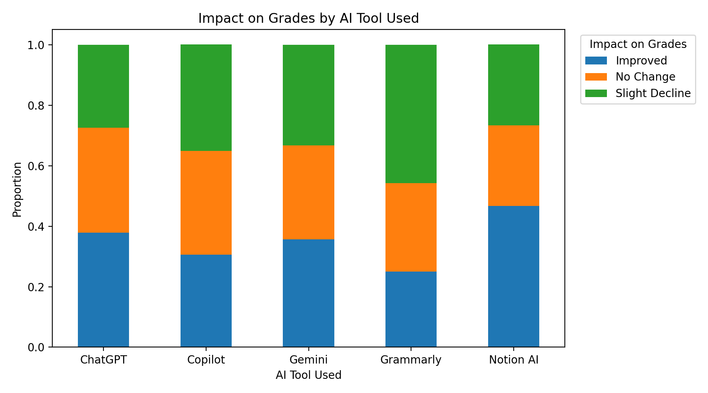
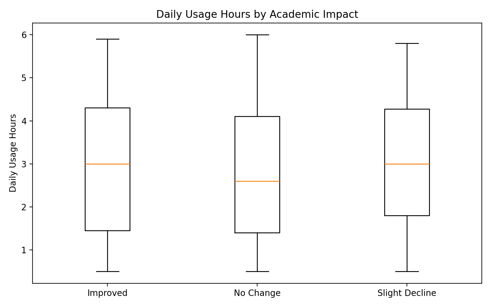
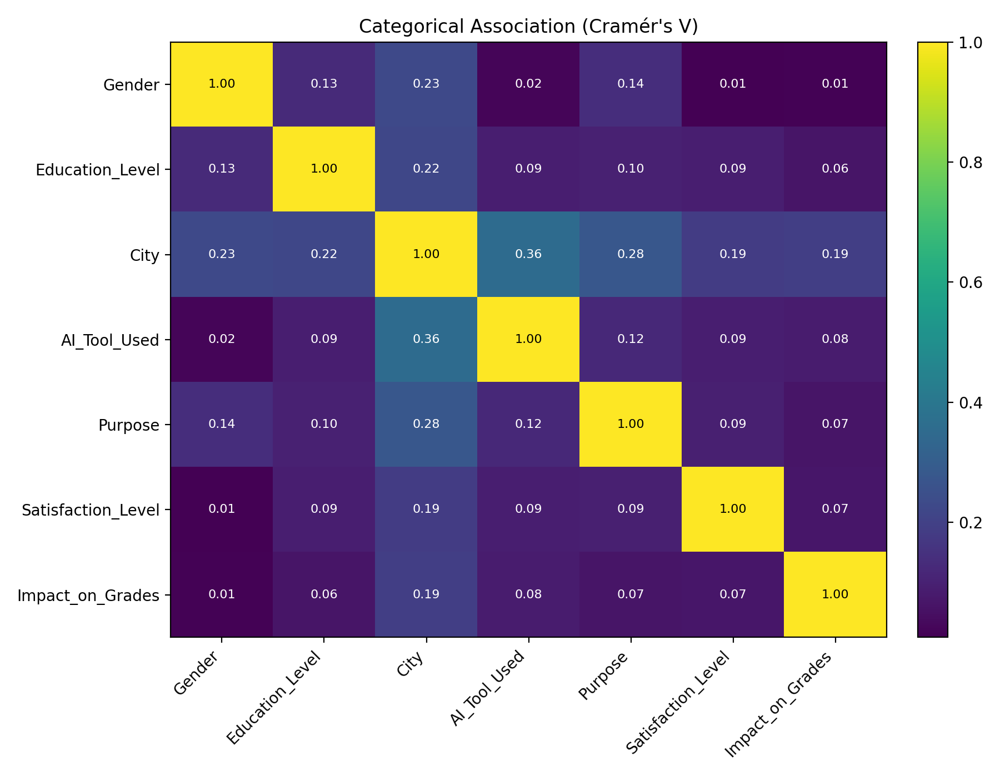
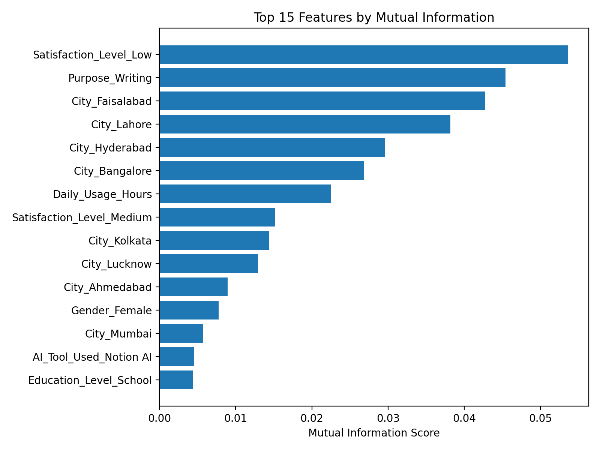
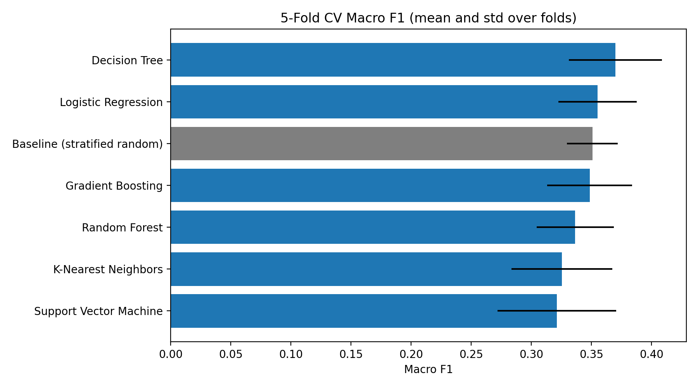
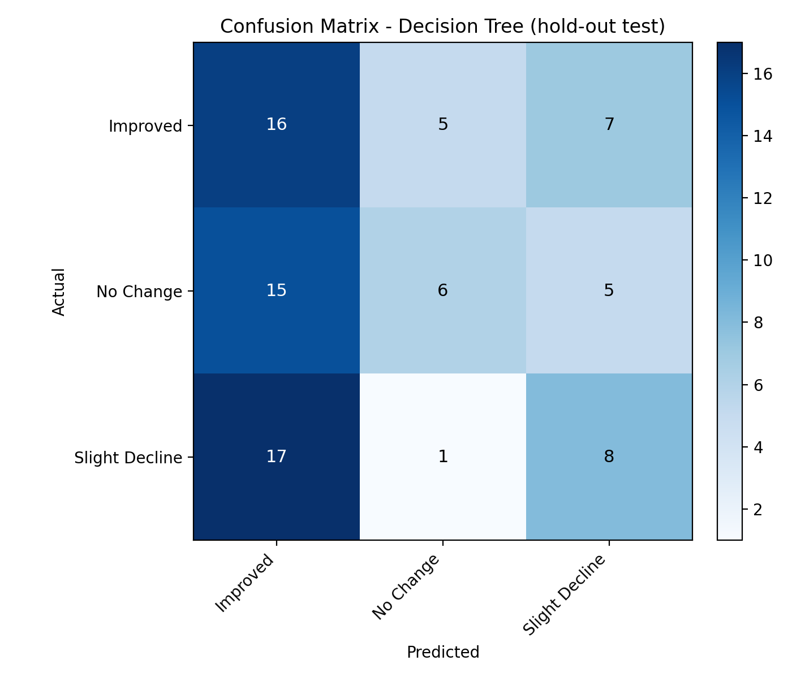

# AI Student Life: Yapay zekâ kullanımı notları etkiliyor mu?

CSE315 Makine Öğrenmesi dersi için yaptığım proje. Öğrencilerin hangi yapay zekâ aracını, ne amaçla ve günde kaç saat kullandığına bakarak notlarına etkisini (`Impact_on_Grades`: Improved / No Change / Slight Decline) tahmin etmeye çalıştım. Çalışma CRISP-DM adımlarını izliyor.

Kısaca sonuç: modeller rastgele tahminden belirgin şekilde iyi değil. Veri setindeki değişkenler bu hedefi açıklamakta yetersiz kalıyor. Ayrıntılar aşağıda.

## Veri

`data/AI_Student_Life_india.csv`: Kaggle'da paylaşılan açık bir veri seti. 400 satır, 10 sütun, eksik değer yok. Sınıflar dengeli (139 / 131 / 130).

| Sütun | Tür |
|---|---|
| Age, Daily_Usage_Hours | sayısal |
| Gender, Education_Level, City, AI_Tool_Used, Purpose, Satisfaction_Level | kategorik |
| Impact_on_Grades | hedef |
| Student_ID | kimlik, modelde kullanılmıyor |

Dosya adı "india" olsa da veri iki ayrı örneklemin birleşimi. İlk 300 satır Hindistan şehirlerinden geliyor. Son 100 satırın hepsi Pakistan şehirlerinden (Lahore, Karachi, Multan...) ve `Student_ID` bu satırlarda 1'den yeniden başlıyor. Bu yüzden 100 ID tekrarlıyor. `City` değişkeni dolaylı olarak "hangi örneklem" bilgisini de taşıyor. Mutual information sıralamasında Faisalabad ve Lahore'un üst sıralarda çıkmasının sebebi büyük ihtimalle bu.

## Keşifsel analiz

Modellemeden önce de tablo pek umut vermiyordu. Araçlara ve kullanım süresine göre sınıf oranları birbirine çok yakın:

<p>
  
  
</p>

Notion AI kullananlarda "Improved" oranı daha yüksek (%47), Grammarly'de ise "Slight Decline" (%46). Ama bu iki grupta sadece 15 ve 24 öğrenci var; bu kadar küçük gruplarda birkaç öğrencinin sınıfı bile oranı ciddi şekilde oynatır. Kalabalık gruplar olan ChatGPT, Gemini ve Copilot (108–129 öğrenci) birbirine çok yakın. Günlük kullanım süresinin dağılımı üç sınıfta neredeyse aynı.

<p>
  
  
</p>

Hedefle en yüksek ilişki `City`'de görünüyor (Cramér's V 0.19). Ancak bu değer kısmen yanıltıcı: 15 kategorili bir değişkende düzeltilmemiş Cramér's V yukarı doğru yanlı oluyor. Üstüne, yukarıda anlatıldığı gibi `City` hangi örneklemden gelindiğini de gösteriyor. Diğer değişkenlerin hepsi 0.1'in altında.

## Yöntem

- **Ön işleme:** sayısal sütunlara `StandardScaler`, kategoriklere one-hot encoding. İkisi de `Pipeline` içinde, yani her fold'da yalnızca eğitim verisine fit ediliyor.
- **Keşifsel analiz:** dağılım grafikleri, araç/amaç bazında hedef oranları, kategorik değişkenler arasında Cramér's V matrisi.
- **Mutual information:** özelliklerin hedefle ilişkisini görmek için hesaplandı. Modeller yine tüm özelliklerle eğitiliyor; bu adım bir seçim yapmıyor, sadece yorumlama amaçlı.
- **Modeller:** Logistic Regression, Decision Tree (max_depth=5), Random Forest, SVM (RBF), KNN (k=7), Gradient Boosting. Karşılaştırma için sınıf oranlarını koruyarak rastgele tahmin yapan bir baseline (`DummyClassifier(strategy="stratified")`) da var.
- **Değerlendirme:** üç farklı kurulum, metrik olarak accuracy ve macro F1:
  1. Stratified 5-fold cross validation
  2. %80 / %20 hold-out
  3. %60 / %20 / %20 train / validation / test (modeller validation'a göre sıralanıyor, test sadece raporlanıyor)
- **Permutation test:** CV'de en iyi çıkan model için, etiketler 200 kez karıştırılarak skorun şansa göre anlamlı olup olmadığı kontrol edildi.

## Sonuçlar

5-fold CV (macro F1, fold'lar arası ortalama ± std):

| Model | Accuracy | Macro F1 |
|---|---|---|
| Decision Tree | 0.383 | 0.370 ± 0.039 |
| Logistic Regression | 0.363 | 0.355 ± 0.033 |
| *Baseline (rastgele)* | *0.355* | *0.351 ± 0.021* |
| Gradient Boosting | 0.353 | 0.349 ± 0.035 |
| Random Forest | 0.340 | 0.337 ± 0.032 |
| KNN | 0.338 | 0.326 ± 0.042 |
| SVM | 0.333 | 0.321 ± 0.049 |



Üç sınıf dengeli olduğu için şans seviyesi yaklaşık 0.33. Modellerin hepsi 0.32 ile 0.38 arasında kalıyor. Dört model baseline'ın altında. Hold-out ve train/val/test sonuçlarında model sıralaması da her seferinde değişiyor: CV'de birinci olan Decision Tree, hold-out'ta KNN ve Gradient Boosting'in gerisinde. Bu da farkların büyük kısmının gürültü olduğunu gösteriyor.

Decision Tree için permutation testinde gerçek etiketlerle F1 0.370, karıştırılmış etiketlerle ortalama 0.310 çıktı (p ≈ 0.02). Ancak bu model altı model arasından en iyisi diye seçildiği için bu p-değeri iyimser. Çoklu karşılaştırma düzeltmesi yapılınca (ör. Bonferroni, 6 model) anlamlılık ortadan kalkıyor.

Hold-out test setinde Decision Tree'nin karışıklık matrisi:



Model "Improved" sınıfını fazla tahmin ediyor. "No Change" sınıfını neredeyse hiç ayırt edemiyor (recall 0.23).

## Yorum

Bu veriyle "yapay zekâ aracı ve kullanım süresi notlara etkiyi belirliyor" denemez. Daha anlamlı bir model için muhtemelen önceki not ortalaması, dersin zorluğu, çalışma alışkanlıkları ve aracın *nasıl* kullanıldığı gibi değişkenler gerekir. Ayrıca hedef değişken öğrencinin kendi beyanı, yani ölçüm de gürültülü.

Bu projeden çıkardığım asıl ders, yüksek skor peşinde koşmadan önce bir baseline ile karşılaştırma yapmanın ve sonuçların farklı split'lerde tutarlı olup olmadığına bakmanın önemi oldu.

## Çalıştırma

```bash
python -m venv .venv
.venv\Scripts\activate        # Linux/macOS: source .venv/bin/activate
pip install -r requirements.txt
python ai_student_life.py
```

Python 3.12 ve scikit-learn 1.8 ile denendi. Tüm tablolar `results/`, grafikler `results/figures/` altına yazılıyor. Rastgelelik `random_state=42` ile sabit, sonuçlar her çalıştırmada aynı.

## Dosyalar

```
ai_student_life.py         analizin tamamı
data/                      veri seti
results/                   CSV/JSON çıktılar
results/figures/           grafikler
```
